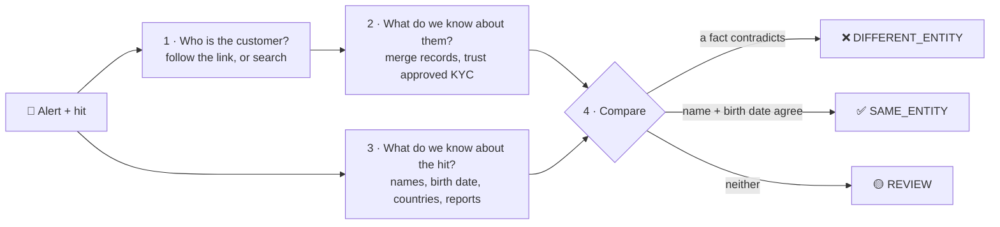

# FinCI: Same Person or Not?

Track 2 (sanctions screening) of the Grok Bot London Financial Crime Hackathon.

For every watchlist hit raised against a bank customer, FinCI decides whether the hit is the
customer (`SAME_ENTITY`), clearly someone else (`DIFFERENT_ENTITY`), or needs a person
(`REVIEW`), with a reason code, the resolved customer record, a short reason and the IDs of
the records that decided it.

## The pipeline at a glance

Contradictions are checked first, a missing fact never counts as a contradiction, and if
in doubt the answer is `REVIEW`.

## How each rule is checked

| Rule (POLICY.md) | What the pipeline checks | Outcome when it fires | Code |
|---|---|---|---|
| **Find the customer** (2) | Follow `account_ref` / `login_handle` / `email`; else search on name, date of birth, country, city. On a joint account, keep the holders who fit those details | The people to compare against | `customers.py` `resolve()` |
| **One person, one picture** (3) | Merge records with the same phone + full date of birth, or the same document number on an approved check | All merged records' facts count | `customers.py` `_build_merge()` |
| **Verified beats declared** (4) | Newest *approved* KYC check or onboarding note gives the legal name, date of birth, document country | Used instead of the record's own values | `customers.py` `kyc_facts()` |
| **Hit's facts** (5) | Date of birth from `dobs` → profile first paragraph → search results with the right listing phrase and a hit country | The hit's possible birth dates | `hits.py` `picture()` |
| **Time** (6) | Customer under 16 at the earliest `According to …; date:` report, company incorporated after it | ❌ `TEMPORAL_IMPOSSIBILITY` | `decide.py` |
| **Deceased** (6) | Hit's date of death is before the screening date | ❌ `DECEASED` | `decide.py` |
| **Type** (6) | One is a person, the other a company | ❌ `ENTITY_TYPE_MISMATCH` | `decide.py` |
| **Date of birth** (6) | *Every* hit date is > 1 year away, or the same year with a different month/day | ❌ `DOB_MISMATCH` | `decide.py` `contradicted()` |
| **Verified name** (6) | Verified legal name agrees with none of the hit's names or aliases | ❌ `NAME_MISMATCH_VERIFIED` | `decide.py` + `names.py` |
| **Location** (6) | *Every* customer country differs from *every* hit country (all hit countries recognised) | ❌ `LOCATION_MISMATCH`, but 🟡 REVIEW if name + birth date agree | `decide.py` |
| **Confirm a person** (7) | Name agrees and the birth year is one of the hit's years with equal month/day where both give one | ✅ `NAME_DOB_LOCATION_MATCH` (country shared) or `NAME_DOB_MATCH` | `decide.py` `agrees()` |
| **Confirm a company** (7) | Name agrees and a country is shared | ✅ `NAME_LOCATION_MATCH` | `decide.py` |
| **Nothing settles it** (7) | No contradiction, not enough agreement | 🟡 `INSUFFICIENT_DATA` | `decide.py` |
| **Several people fit** (3) | Decide each person; if the decisions differ… | 🟡 `AMBIGUOUS_CUSTOMER_RECORD` | `main.py` `decide_hit()` |
| **Names** (8) | Ignore case/accents/brackets; parts match if identical, listed variants, joined/split, or within 1 edit (4–6 letters) / 2 edits (7+). Two matching parts, or every part of the shorter name, means agreement. Placeholders and legal forms don't count | Used by search, the name test and confirm | `names.py` `agree()` |
| **Cite evidence** (9) | Each fact keeps its source ID; only the IDs behind the deciding test are cited | `evidence`, `customer_record_id` | `decide.py`, `main.py` |

When several contradictions fire, the code is picked in the order above (time first).
Clause-by-clause detail: [`system/POLICY_MAP.md`](system/POLICY_MAP.md).

## Running it

* Run: `system/run <data folder> <output file>` (Python 3 standard library only, about 5 s, no API calls)
* Development predictions: `output/dev.jsonl`
* Design, evidence model, determinism and worked cases: [`system/README.md`](system/README.md)
* Unit tests: `python3 -m unittest discover -s system/tests`

The development data is not in this repository: it is for event participants only.
