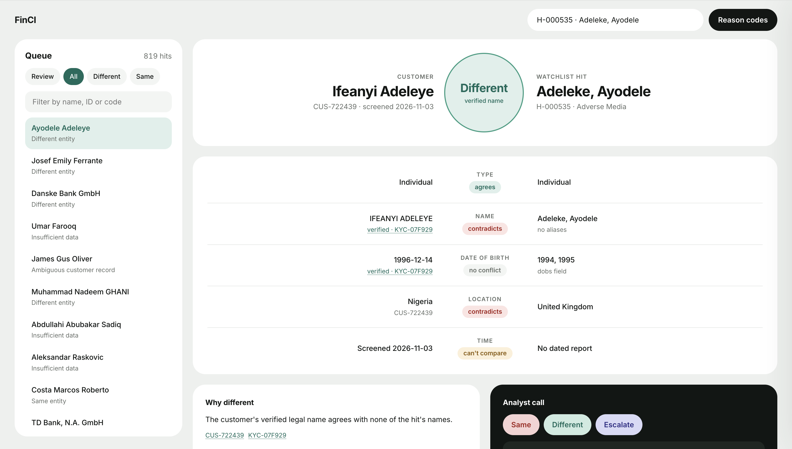
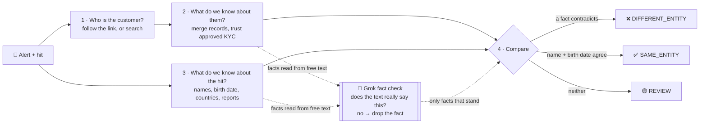

# FinCI: Same Person or Not?



## Grok layer

Settings: `GROK_API_KEY` (or `XAI_API_KEY`) and `GROK_MODEL` (default `grok-4.7`), from the
environment or `.env`. The fact check can also run through OpenRouter (`OPENROUTER_API_KEY`); the
normaliser uses the xAI key only. `LLM=0` turns off normalisation, `FACT_CHECK=0` the fact check. Without a
key the system runs on the rules alone and its output is what it was before Grok was added.

1. **Normalise** (`normalize.py`, before the rules run). A value the rules cannot read is sent to
   Grok and the answer is written back into the loaded record in the form the rules already use.
   A value the rules can read is never sent.

   | Category the value feeds | Values asked | Written back as |
   |---|---|---|
   | `DOB_MISMATCH`, `TEMPORAL_IMPOSSIBILITY`, `DECEASED`, name+dob matches | dates of birth, check dates, screening dates, death dates | ISO `YYYY`, `YYYY-MM` or `YYYY-MM-DD` |
   | `LOCATION_MISMATCH`, `NAME_LOCATION_MATCH` | country fields; a city, state or region as the last part of an address or place of birth | canonical country name (added as the address's last part) |
   | `ENTITY_TYPE_MISMATCH` | blank or unusual entity types | `Individual` or `Company` |

2. **Fact check** (`fact_check.py`). Each free-text reading the rules make is checked; a reading
   Grok rejects is dropped (unknown), never replaced.

**Same answer every time.** Every question is asked 5 times at temperature 0 and an answer is used
only when all 5 agree (`llm.VOTES`). A split leaves the rules' reading. Answers and splits are saved
under the exact question (`.cache/llm/`, `debug/fact_check.jsonl`), so later runs reuse them and make
no calls: repeated runs give byte-identical output.

**Kept to the policy on purpose.** Names are still matched only by principle 8 (`name_variants.json`
groups, joined/split parts, the edit limit): LLM name groups would match names the policy says do not
match. Dated reports are still only the exact "According to …; Month d, yyyy:" lines (principle 5).


## Overview

Track 2 (sanctions screening) of the Grok Bot London Financial Crime Hackathon.

For every watchlist hit raised against a bank customer, FinCI decides whether the hit is the
customer (`SAME_ENTITY`), clearly someone else (`DIFFERENT_ENTITY`), or needs a person
(`REVIEW`), with a reason code, the resolved customer record, a short reason and the IDs of
the records that decided it.

### Pipeline overview



Contradictions are checked first, a missing fact never counts as a contradiction, and if
in doubt the answer is `REVIEW`.

## Setup

Follow these steps to set up and run the project.

### Clone the repository

```bash
git clone https://github.com/saifoaj/GrokBotHackathon.git
cd GrokBotHackathon
```

### Install Python

Install Python 3 if you don't have it already ([Python download](https://www.python.org/downloads/)).
There is nothing else to install: the code uses only the standard library.

### Add the data

The development data is for event participants only, so it is not in this repository.
Download it from the data room and put it in a `dev/` folder.

### Add the Grok key (optional)

Create a `.env` file to turn on the LLM fact check:

```bash
GROK_API_KEY=your-key-here
```

Without the key, only the rules run.

### Run the UI

Build the UI's data from the `dev/` folder:

```bash
python3 ui/build_data.py
```

Open the UI in your browser (no server needed):

```bash
open ui/index.html
```

On Windows use `start ui\index.html`, and on Linux `xdg-open ui/index.html`.

### Run the pipeline only

```bash
system/run dev output/dev.jsonl
```

### Score

```bash
python3 validate.py --data dev --output output/dev.jsonl --score dev/practice_labels.jsonl
```

### Test

```bash
python3 -m unittest discover -s system/tests
```

More detail on the design: [`system/README.md`](system/README.md).

## How each rule is checked

| Rule (POLICY.md)                   | What the pipeline checks                                                                                                                                                                                                                               | Outcome when it fires                                             | Code                            |
| ---------------------------------- | ------------------------------------------------------------------------------------------------------------------------------------------------------------------------------------------------------------------------------------------------------ | ----------------------------------------------------------------- | ------------------------------- |
| **Find the customer** (2)          | Follow `account_ref` / `login_handle` / `email`; else search on name, date of birth, country, city. On a joint account, keep the holders who fit those details                                                                                         | The people to compare against                                     | `customers.py` `resolve()`      |
| **One person, one picture** (3)    | Merge records with the same phone + full date of birth, or the same document number on an approved check                                                                                                                                               | All merged records' facts count                                   | `customers.py` `_build_merge()` |
| **Verified beats declared** (4)    | Newest _approved_ KYC check or onboarding note gives the legal name, date of birth, document country                                                                                                                                                   | Used instead of the record's own values                           | `customers.py` `kyc_facts()`    |
| **Hit's facts** (5)                | Date of birth from `dobs` → profile first paragraph → search results with the right listing phrase and a hit country                                                                                                                                   | The hit's possible birth dates                                    | `hits.py` `picture()`           |
| **Free-text facts hold up** (4, 5) | 🤖 Grok confirms that each reading from a note, profile sentence or search snippet is what the text says                                                                                                                                               | A rejected reading is dropped (never replaced)                    | `fact_check.py`                 |
| **Time** (6)                       | Customer under 16 at the earliest `According to …; date:` report, company incorporated after it                                                                                                                                                        | ❌ `TEMPORAL_IMPOSSIBILITY`                                       | `decide.py`                     |
| **Deceased** (6)                   | Hit's date of death is before the screening date                                                                                                                                                                                                       | ❌ `DECEASED`                                                     | `decide.py`                     |
| **Type** (6)                       | One is a person, the other a company                                                                                                                                                                                                                   | ❌ `ENTITY_TYPE_MISMATCH`                                         | `decide.py`                     |
| **Date of birth** (6)              | _Every_ hit date is > 1 year away, or the same year with a different month/day                                                                                                                                                                         | ❌ `DOB_MISMATCH`                                                 | `decide.py` `contradicted()`    |
| **Verified name** (6)              | Verified legal name agrees with none of the hit's names or aliases                                                                                                                                                                                     | ❌ `NAME_MISMATCH_VERIFIED`                                       | `decide.py` + `names.py`        |
| **Location** (6)                   | _Every_ customer country differs from _every_ hit country (all hit countries recognised)                                                                                                                                                               | ❌ `LOCATION_MISMATCH`, but 🟡 REVIEW if name + birth date agree  | `decide.py`                     |
| **Confirm a person** (7)           | Name agrees and the birth year is one of the hit's years with equal month/day where both give one                                                                                                                                                      | ✅ `NAME_DOB_LOCATION_MATCH` (country shared) or `NAME_DOB_MATCH` | `decide.py` `agrees()`          |
| **Confirm a company** (7)          | Name agrees and a country is shared                                                                                                                                                                                                                    | ✅ `NAME_LOCATION_MATCH`                                          | `decide.py`                     |
| **Nothing settles it** (7)         | No contradiction, not enough agreement                                                                                                                                                                                                                 | 🟡 `INSUFFICIENT_DATA`                                            | `decide.py`                     |
| **Several people fit** (3)         | Decide each person; if the decisions differ…                                                                                                                                                                                                           | 🟡 `AMBIGUOUS_CUSTOMER_RECORD`                                    | `main.py` `decide_hit()`        |
| **Names** (8)                      | Ignore case/accents/brackets; parts match if identical, listed variants, joined/split, or within 1 edit (4–6 letters) / 2 edits (7+). Two matching parts, or every part of the shorter name, means agreement. Placeholders and legal forms don't count | Used by search, the name test and confirm                         | `names.py` `agree()`            |
| **Cite evidence** (9)              | Each fact keeps its source ID; only the IDs behind the deciding test are cited                                                                                                                                                                         | `evidence`, `customer_record_id`                                  | `decide.py`, `main.py`          |

When several contradictions fire, the code is picked in the order above (time first).
Clause-by-clause detail: [`system/POLICY_MAP.md`](system/POLICY_MAP.md).

## The LLM fact check

The rules make every decision. Grok does one small job: when a fact is read from free text
(a note, a profile sentence, a search snippet), Grok checks that the text really says it.

- ✅ It agrees: the fact is used.
- ❌ It disagrees: the fact is dropped. Nothing replaces it.

Grok never adds facts or makes decisions. On the dev set it sent 9 hits to `REVIEW` and
created no new clears or matches. Without `GROK_API_KEY` (or with
`FACT_CHECK=0`) the check is skipped and only the rules run. Code: `system/fact_check.py`.
