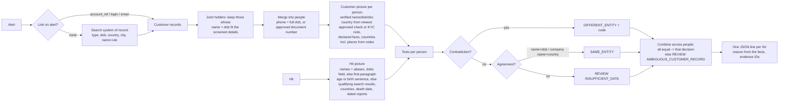

# FinCI: Same Person or Not?

FinCI decides, for every sanctions, PEP, enforcement or adverse-media hit, whether the
hit is the bank's customer (`SAME_ENTITY`), clearly someone else (`DIFFERENT_ENTITY`), or
needs a person (`REVIEW`). It follows `POLICY.md` rule by rule, is fully deterministic and
uses only the Python 3 standard library. No language model is called.

```
system/run <data folder> <output file>
```

| | |
|---|---|
| Run time (development set, 819 hits, 72k customers) | about 5 seconds on a laptop |
| Cost per run | 0 (no API calls) |
| Practice labels (`validate.py --score`) | 50 / 50 right, 0 unsafe clearances, decision score 100.0 |
| Reproducibility | byte-identical output across runs, shuffled input files and hash seeds |

## Architecture



| File | Job |
|---|---|
| `run` | Entry point (shell). Sets `PYTHONHASHSEED=0`, finds Python, calls `main.py`. |
| `main.py` | Loop over alerts and hits, error guard (a failing hit becomes REVIEW, never a missing line), writer. |
| `load.py` | Reads the JSON Lines files, sorts every collection by ID, builds the indexes. |
| `norm.py` | Dates (ISO, day-first slashes, `27 June 1967`, `June 27, 1967`, partial dates), phones, lists. |
| `countries.py` | Country names, ISO codes and nationality words to one canonical name; finds countries in free text. |
| `names.py` | The name rule of principle 8 (variants, joined/split parts, edit limits, placeholders, legal forms). |
| `customers.py` | Links, search, joint-holder choice, merge into people, customer picture, KYC-note reader. |
| `hits.py` | Hit picture: names, birth dates from the three sources, countries, death, dated reports. |
| `decide.py` | The five contradiction tests, the agreement test, reason sentences and evidence. |

## How the customer is found (both sides resolved)

1. **Links first.** `account_ref` goes to accounts, then to customer records; `login_handle`
   to accounts, then to customers; `email` to customers. If a link leads to several people
   (a joint account), only those whose name and date of birth fit the screened details are
   kept.
2. **No link: search.** Records of the same type whose date of birth equals the screened one
   in every part both give, whose residence or nationality is the screened country, whose
   city or address contains the screened city, and whose full, preferred or login name agrees
   with the screened name under the policy name rule. A blocking index on name parts (first
   three letters and name-variant groups) keeps this to a few hundred comparisons.
3. **One person, one picture.** A union-find joins records that share a phone number and the
   same full date of birth, or whose approved checks carry the same document number,
   transitively. A shared phone or address alone never merges.
4. **Verified beats declared.** For each person the newest approved check, from the KYC
   provider or a `kyc` onboarding note, gives the legal name, date of birth and document
   country. Rejected and expired checks are ignored. Without a verified date of birth, every
   declared one is kept, and a test must hold under all of them.
5. **Countries tied to the person:** residence and nationality on every record, the document
   country of approved checks, and countries named in support notes ("lived and worked in
   Ghana from 2009 to 2015").

## How the listed person is found

* Names: the name, `best_matching_name`, aliases (nicknames included) and first/middle/last.
* Date of birth, first source that gives one: the `dobs` field; else the first paragraph of the
  profile notes (an age at a date gives two possible years; "born on 17 July 1939" gives the
  date); else search results for the name. A result counts only when it uses the listing
  phrase for the hit's category and names a country tied to the hit. Most results are about
  namesakes and are ignored.
* Countries: `countries`, `nationality`, `citizenship`, last part of each address and of the
  place of birth; "International" and "Europe" are dropped.
* Dated reports: only lines of the exact form `According to ...; Month d, yyyy:`.

## Decision rules

Every test returns *fired*, *not fired* or *unknown*. **Unknown never fires**: a missing date,
country or name is never a mismatch.

* **Clear** only on: time (customer under 16 at the earliest dated report even on the most
  favourable reading, a company incorporated after it, or a death date before screening);
  date of birth (every hit date contradicted: more than one year apart, or a different month
  or day in the same year); location (every customer country differs from every hit country,
  and only when all hit countries are recognised); verified legal name agreeing with none of
  the hit's names; or person versus company.
* A country difference does **not** clear a hit whose name and date of birth agree: it stays
  REVIEW.
* **Confirm** a person on name + date of birth agreement, a company on name + shared country,
  in both cases with nothing contradicting.
* An individual whose names have fewer than two real parts (placeholders such as N/A do not
  count) can be neither cleared nor confirmed on name.
* Several people fit: each is decided; if all agree that decision stands with
  `customer_record_id = AMBIGUOUS`, otherwise `REVIEW / AMBIGUOUS_CUSTOMER_RECORD`.

## How evidence is represented

Every fact in a picture keeps the ID of the record it came from. The evidence list holds only
the IDs behind the facts that decided the hit:

* date of birth or time tests: the check or note that gave the birth date, plus `SR-` IDs when a
  search result gave the hit's birth year;
* verified-name test: the check or note with the legal name;
* location test: the person's customer records plus the checks and notes that tied the extra
  countries;
* match or review: the customer records plus the newest approved check (and the birth-date
  source when it agreed).

The reason is two to four sentences built from the same facts, quoting this hit's own values,
and saying plainly what is missing when the answer is REVIEW.

## Determinism

No clock, randomness, network or model in the decision path. Files are sorted by ID after
loading, every set and dict is iterated in sorted order, and output lines are sorted by
(alert, hit). Running on copies of the data with shuffled line order, shuffled keys and
different `PYTHONHASHSEED` values gives a byte-identical output file.

## Honesty about missing data

* When a hit gives no birth date anywhere, it is never confirmed; it can only be cleared on
  name, location, type, time or death.
* A hit country that we cannot recognise as a country blocks the location test rather than
  risking a wrong clear.
* KYC notes are read with patterns for dates, countries and the capitalised legal name; a note
  that mentions a rejection, expiry or failure is not used as evidence.
* Ages in free text give two possible birth years, never one.

## Three worked cases (from the development set)

### 1. Clear mismatch: `H-13E1CF` -> DIFFERENT_ENTITY, TEMPORAL_IMPOSSIBILITY

* Route: `account_ref ACC-B3E19A` -> `CUS-364225`; the same phone number and the same full date
  of birth merge `CUS-851234` into the same person.
* Customer: newest approved check `KYC-358C76` gives date of birth 2007-08-21.
* Hit "Abdul Rahman": the earliest dated report in its profile is 2020-01-08.
* The customer was at most 13 then, so the hit cannot be them. The countries also differ
  (Singapore, United States against Pakistan).
* Evidence: `CUS-364225`, `CUS-851234`, `KYC-358C76`.

### 2. Match: `H-582410` -> SAME_ENTITY, NAME_DOB_LOCATION_MATCH

* Route: `account_ref ACC-C4CA34` is a joint account (CUS-377745 and CUS-508976); the screened
  name and date of birth fit `CUS-377745` only.
* Customer: onboarding note `NOTE-14E25A` records an approved check: ELVIRA VELASCO MORILLO,
  born 1968-03-05.
* Hit "Elvira Velasco Morillo": first profile sentence "aged 30 in November 1998" gives
  1967 or 1968; linked to Spain.
* Name, birth year and country all agree; nothing contradicts.
* Evidence: `CUS-377745`, `NOTE-14E25A`.

### 3. Left for review: `H-FA9F83` -> REVIEW, INSUFFICIENT_DATA

* Route: `account_ref ACC-08D260` -> `CUS-783545`; newest approved check `KYC-80B445` gives the
  legal name DIANA CIRSTIAN (a one-swap typo of Cristian, two edits, within the limit for a
  long part).
* Hit "Diana Cristian": linked to Moldova, like the customer, but no birth date in its fields,
  profile or any qualifying search result.
* Nothing contradicts and nothing confirms, so a person decides.
* Evidence: `CUS-783545`, `KYC-80B445`.

## Running and checking

```
system/run dev output/dev.jsonl
python3 validate.py --data dev --output output/dev.jsonl --score dev/practice_labels.jsonl
```

Set `SCREEN_TRACE=debug/trace.jsonl` to write a per-hit trace (route, people, hit facts,
tests fired). The trace folder is not committed.
